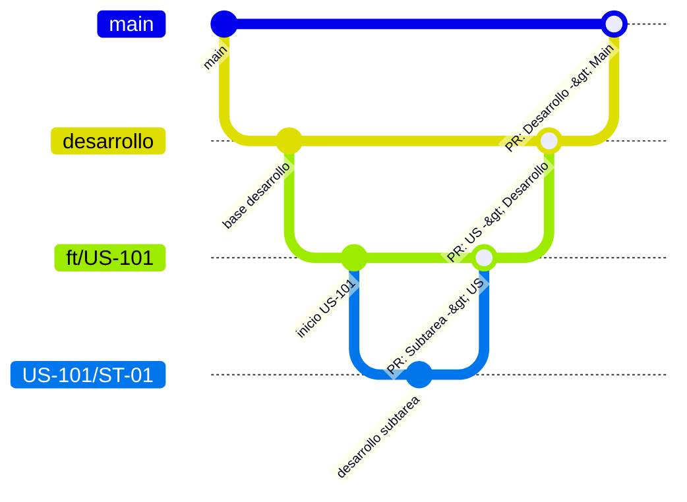

# DonaKit - Frontend

Aplicación cliente para el proyecto **DonaKit**, desarrollada con [Next.js](https://nextjs.org/) (App Router), [React](https://react.dev/), [TypeScript](https://www.typescriptlang.org/) y [Tailwind CSS](https://tailwindcss.com/).

---

## 📌 Versiones Exactas del Entorno

Para garantizar que todos los desarrolladores tengan el mismo comportamiento y dependencias:

| Herramienta / Paquete | Versión Exacta / Instalada |
| :--- | :--- |
| **Node.js** | `v24.21.0` (definida en `.nvmrc`) |
| **npm** | `v11.19.0` |
| **Next.js** | `16.4.0` |
| **React** | `19.3.0` |
| **React DOM** | `19.3.0` |
| **Tailwind CSS** | `^4.0.0` (con `@tailwindcss/turbopack`) |
| **TypeScript** | `^5.0.0` |
| **ESLint** | `^9.0.0` |

> 💡 **¿Es necesario Docker para compartir las mismas versiones?**  
> **No es obligatorio para el frontend.** Con el archivo `package-lock.json` y ejecutando `npm ci`, npm descarga con exactitud milimétrica las mismas versiones para todos los colaboradores del equipo sin desviaciones.  
> Con `.nvmrc` en la raíz, los desarrolladores pueden sincronizar su versión de Node con `nvm use`.

---

## 📦 Instalación de Dependencias

1. Navega hasta el directorio del frontend:
   ```bash
   cd donakit-frontend
   ```

2. Sincroniza la versión de Node (si usas `nvm` o `fnm`):
   ```bash
   nvm use
   ```

3. Instala exactamente las dependencias del proyecto:
   ```bash
   npm ci
   ```
   *(Recomendado `npm ci` sobre `npm install` para respetar rigurosamente el `package-lock.json`).*

---

## 🚀 Ejecución del Proyecto

### Modo Desarrollo

```bash
npm run dev
```

Por defecto Next.js intentará usar el puerto `3000`. Si el backend ya está usando ese puerto, puedes indicar un puerto alternativo (por ejemplo `3001`):

```bash
npm run dev -- -p 3001
```

La aplicación estará disponible en: [http://localhost:3001](http://localhost:3001).

---

### Modo Producción

```bash
# 1. Compilar y optimizar la aplicación
npm run build

# 2. Iniciar el servidor Next.js de producción
npm run start
```

---

## 🧪 Calidad de Código y Linting

```bash
npm run lint
```

---

## 🤖 Skills y Asistentes de IA para el Equipo

- **Skill de Next.js en el repositorio**: Ubicada en `.agents/skills/nextjs/SKILL.md`. Cualquier compañero que trabaje con **Antigravity IDE** o **Gemini CLI** dispondrá de las convenciones y directrices de Next.js 16 de forma nativa sin configuraciones adicionales.
- **Herramientas de Next.js**: `next` está incluido en las dependencias, por lo que comandos adicionales pueden ejecutarse directamente mediante:
  ```bash
  npx next --help
  ```

---

## 🌿 Flujo de Trabajo con Git (Branching & PRs)

Para mantener el orden y la calidad del código, el equipo sigue una estrategia de ramificación jerárquica estricta:

### 1. Jerarquía y Nomenclatura de Ramas

| Nivel | Tipo de Rama | Origen (*Branch off*) | Nomenclatura | Ejemplo | Descripción |
| :---: | :--- | :--- | :--- | :--- | :--- |
| **1** | Producción | - | `main` | `main` | Código estable y desplegable. |
| **2** | Desarrollo | `main` | `desarrollo` | `desarrollo` | Rama base de integración activa del equipo. |
| **3** | Historia de Usuario | `desarrollo` | `ft/US-XXX` | `ft/US-101` | Funcionalidad o historia de usuario completa. |
| **4** | Subtarea | `ft/US-XXX` | `US-XXX/ST-XX` | `US-101/ST-01` | Tarea técnica puntual dentro de la US. |



### 2. Orden Jerárquico Obligatorio de Pull Requests (PRs)

Los PRs **siempre deben fusionarse en orden ascendente**, sin saltar niveles:

1. **Subtarea ➔ Historia de Usuario (`US-XXX/ST-XX` ➔ `ft/US-XXX`):**  
   Al culminar la subtarea, se crea un PR con destino a la rama de su User Story.
   ```bash
   # Crear la rama de subtarea partiendo de la US
   git checkout ft/US-XXX
   git pull origin ft/US-XXX
   git checkout -b US-XXX/ST-XX
   ```
2. **Historia de Usuario ➔ Desarrollo (`ft/US-XXX` ➔ `desarrollo`):**  
   Cuando todas las subtareas estén aprobadas y fusionadas en la US, se crea un PR desde `ft/US-XXX` hacia `desarrollo`.
   ```bash
   # Crear la rama de US partiendo de desarrollo
   git checkout desarrollo
   git pull origin desarrollo
   git checkout -b ft/US-XXX
   ```
3. **Desarrollo ➔ Main (`desarrollo` ➔ `main`):**  
   Al cierre del sprint o ciclo de entrega, una vez validadas todas las funcionalidades integradas, se genera el PR hacia `main`.

> ⚠️ **Regla importante:** Las ramas de subtareas (`US-XXX/ST-XX`) **nunca** se abren desde `desarrollo` ni se envían en PR directo a `desarrollo` o `main`. Siempre se integran primero a su rama `ft/US-XXX`.

---

## 🏗️ Arquitectura y Mejores Prácticas del Frontend

El proyecto sigue la arquitectura recomendada para **Next.js 16 con App Router**, aplicando el principio de separación de responsabilidades y composición modular:

> 💡 **Nota sobre el enrutamiento:**  
> En Next.js 16 con App Router **no se utiliza la carpeta `pages/`** (que corresponde al Pages Router legado). Las rutas se manejan enteramente dentro del directorio `app/` mediante archivos `page.tsx`, `layout.tsx` y grupos de rutas `(nombre)`.

### 📂 Estructura Modular de Carpetas

```text
donakit-frontend/
├── app/                        # Capa de Enrutamiento (Next.js App Router)
│   ├── (auth)/                 # Route Group: Páginas de autenticación (login, registro)
│   ├── (dashboard)/            # Route Group: Vistas del panel principal
│   ├── api/                    # Route Handlers para endpoints internos (route.ts)
│   ├── favicon.ico
│   ├── globals.css             # Estilos globales y tokens de Tailwind CSS v4
│   ├── layout.tsx              # Layout raíz (proveedores, metadatos, fuentes)
│   ├── not-found.tsx           # Página 404 personalizada
│   ├── error.tsx               # Captura de errores en cliente (Error Boundary)
│   ├── loading.tsx             # Estado de carga esqueleto (Suspense)
│   └── page.tsx                # Página de inicio (Landing / Home)
│
├── components/                 # Componentes visuales de la interfaz
│   ├── ui/                     # Componentes base y primitivas reutilizables (Button, Input, Modal, Card)
│   ├── layout/                 # Elementos estructurales compartidos (Navbar, Sidebar, Footer)
│   └── features/               # Componentes ligados a dominios específicos (DonationCard, UserProfile)
│
├── services/                   # Capa de Comunicación con el Backend (API NestJS)
│   ├── api-client.ts           # Cliente HTTP centralizado (fetch/axios con interceptores y tokens)
│   └── ...service.ts           # Servicios de consumo por recurso (auth.service.ts, donation.service.ts)
│
├── hooks/                      # Custom Hooks reutilizables (useAuth, useDebounce, useMediaQuery)
├── context/                    # Providers de estado global en cliente (AuthContext, ThemeContext)
├── types/                      # Definiciones de tipos e interfaces TypeScript del proyecto
├── lib/                        # Funciones de utilidad pura y librerías externas (utils.ts con cn, formateadores)
├── constants/                  # Constantes del sistema (rutas, roles, mensajes)
├── public/                     # Archivos estáticos públicos (imágenes, iconos, SVGs)
├── next.config.ts              # Configuración de Next.js
├── tsconfig.json               # Configuración de TypeScript
└── package.json                # Dependencias y scripts
```

### 🎯 Principios de Desarrollo en Frontend
1. **Server Components por Defecto**: Todos los componentes dentro de `app/` son Server Components para maximizar rendimiento y SEO.
2. **Client Components Aislados**: Solo agregar `'use client'` en componentes que requieran interactividad (`useState`, `useEffect`, eventos del mouse o APIs del navegador).
3. **Componentes UI Agnósticos**: Los componentes en `components/ui/` no deben acoplarse a llamadas al backend; deben recibir sus datos por `props`.
4. **Consumo Centralizado de API**: Toda petición al backend debe gestionarse a través de la carpeta `services/`, nunca mediante llamadas `fetch` dispersas dentro de los componentes.
```
